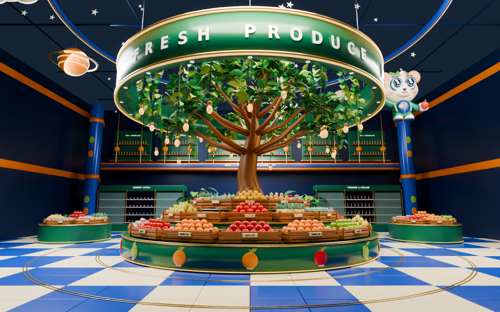

# Fresh Produce Department

This is an editable, additive environment-art module for Unity 6000.3.26f1 and URP 17.3.0. It does not replace the supermarket FBXs, rebuild the main scene, or add shopping/gameplay systems.



**Preview gallery:** [Arrival / complete ring](Previews/FreshProduce/01-hero.png) · [First-person eye height](Previews/FreshProduce/02-eye-level.png) · [Elevated layout](Previews/FreshProduce/03-elevated.png) · [Produce and crate detail](Previews/FreshProduce/04-detail.png)

## Art direction and comparison

The previous produce view (`Docs/Previews/02-fresh-garden.png`) already contained a green ring, a small central tree, blue/orange architecture, and a polished floor. Its main differences from the supplied reference were the empty volume beneath the ring, shallow single-row product arrangements, a small tree canopy, limited wooden crates and hanging plants, and a mascot placed in the middle of the sign opening.

The new department concentrates on the reference's defining forms: a broad emerald sign ring with warm edge lighting and physical white lettering; a tree and hanging foliage that fill the overhead volume; a tiered radial produce display; carefully stocked wooden crates; satellite islands; and an offset mascot. A clear green identity sits within the existing cobalt/orange visual language.

The reference is an art-direction target, not a camera-calibrated architectural plan. The module uses human-scale fixtures and walking clearances. It retains the project's stylized mascot and licensed produce design language rather than reproducing every shape and surface in the reference.

## Delivered environment files

| File | Purpose |
| --- | --- |
| `ArtSource/SipoFreshProduce.blend` | Editable Blender department and render cameras |
| `Assets/FreshProduce/Models/SipoFreshProduce.fbx` | Department architecture, display fixtures, decor, and vegetation |
| `Assets/FreshProduce/Models/SipoProduceLibrary.fbx` | Reusable produce meshes |
| `Assets/FreshProduce/fresh-produce.json` | Department assembly, material, light, reflection, collider, and placement data |
| `Tools/build_fresh_produce.py` | Reproducible source-generation and export script |
| `Docs/Previews/FreshProduce/` | Offline renders of the delivered 3D geometry |

The nominal department floor is **26 × 26 metres**. Its main display has a **4.9-metre outer radius**, with crate decks near **0.96, 1.43, and 1.87 metres** and heaped merchandise above them. The green overhead sign has a **5.45-metre radius**, extending approximately **5.7–7.0 metres** above the floor. A decorative tree rises through the centre. Floor-level displays are separated by clear circulation space; higher merchandise and overhead decorations are visual set dressing rather than interactive items.

The department contains **74 stocked wooden crates**, **1,851 produce and merchandise instances** (including 232 bottles and 44 fish), four satellite islands, two refrigerated display banks, 24 pendant bulbs, and a tree with 2,160 shaped leaves. The library contains **22 reusable assets**. There are **106 paired LOD groups**: the high-detail scene contains **1,779,433 triangles**, while alternate low-detail meshes contain **361,794 triangles**, plus the architecture that remains visible at either level. These are geometry counts, not measured runtime budgets; Unity selects LODs per assembly.

The stocked upper arcade is a scenic facade, **not a walkable mezzanine**. The existing supermarket's separate two-floor layout remains unchanged.

Unity-native material and prefab assets are assembled by the Editor installer on the user's licensed machine. Their generation is intentionally separate from installing into a custom scene. The FBXs, Blender source, textures, and assembly data are delivered directly; a locally generated prefab must not be confused with a prefab already produced or tested in the unlicensed cloud editor.

## Placement and existing-scene safety

The preferred produce position, around Unity **(-14.2, 0, -2)**, is already occupied in the repository's existing supermarket. A full-size replacement would intersect the old island, overhead ring, nearby column, and surrounding displays. The installer must not silently delete or disable those assets.

When that position conflicts, use the installer's separate staging location outside the existing supermarket's occupied bounds. This permits inspection of the complete module without changing the original layout. **Staging is not a new connected wing:** the module is not automatically accessible through the supermarket's walls from the existing player spawn. Inspect it in Scene view or position it manually in a deliberately prepared space. No wall opening, access bridge, player teleport, or controller change is part of this art task.

Back up the project and save a copy of the current scene before installation. Never run the old whole-supermarket scene builder merely to add this department. Review placement, surrounding walkways, collision clearance, local lights, and camera composition before saving your customized scene.

## Install and preview in Unity

1. Back up the project, pull the repository update, and let Unity **6000.3.26f1 / URP 17.3.0** finish importing and compiling. Open the existing supermarket scene and **Save As** a working copy.
2. Choose **Sipo → Install Fresh Produce Department**. This builds missing materials and prefabs, remaps the new FBXs, and adds one connected prefab instance. It does not save the scene automatically. Read the Console placement message; the original layout normally requires the separate staging location described above.
3. Choose **Sipo → Frame Fresh Produce Department** to select the new root and focus Scene view. Use Scene view's normal flythrough navigation to inspect the complete department. Enable Scene Lighting and Scene Effects when assessing local light and emissive appearance. The original player and camera remain where you put them.
4. Inspect the island at human eye height (approximately **1.65–1.75 m**) and from above. Check the paths around the central and satellite displays, the readable sign, shelf depth, foliage, and the local scene context before deciding on final placement.
5. Save the working scene under a unique asset path before reflection capture. Choose **Sipo → Capture Fresh Produce Reflections**. This requires the licensed Editor with a graphics device and creates persistent, scene-specific HDR cubemaps.
6. Choose **Sipo → Validate Fresh Produce Department**. A successful configuration check writes `SIPO_FRESH_PRODUCE_VALIDATED` to the Console. Fix any reported material, collider, LOD, reflection, or placement problem before integration. Then inspect the result and save the scene manually.

The independent **Sipo → Build Fresh Produce Prefab Library** command creates assets without installing a scene instance. The main prefab is `Assets/FreshProduce/Prefabs/FreshProduceDepartment.prefab`; reusable products, plants, and fixtures are under `Assets/FreshProduce/Prefabs/Library/`. The installer creates its own materials under `Assets/FreshProduce/Materials/`. Existing exact-name materials under `Assets/Materials/` are reused without rewriting their properties. It configures only the new FBXs' material import/remap settings and new module textures' import settings; original model and texture importers remain unchanged.

Running Install again preserves the existing instance and locally customized prefab. It does not reset transforms, regenerate the customized main prefab, or add another copy. Undo immediately after installation removes the new scene instance while retaining generated library assets. To remove the module later, remove its dedicated root; do not delete shared source materials or the original supermarket's objects.

## Lighting, materials, and reflections

The module adds **at most seven local lights, one shadow-casting light, and two reflection probes**. The lights are realtime for immediate inspection; the reflection probes capture on demand and retain their cubemaps. There are no per-frame reflection captures, automatic lightmap bakes, gameplay scripts, or changes to global render settings.

The existing cinematic configuration remains authoritative: the department does not change pipeline selection, exposure, bloom, tonemapping, global volumes, or player-camera settings. A global cinematic volume already present in the scene continues to affect cameras that use it. If the original supermarket has not received the cinematic pass, follow [Cinematic Lighting](CINEMATIC_LIGHTING.md) separately and inspect the combined light budget. Do not repeatedly apply unrelated scene-generation commands to tune this module.

New materials use **Universal Render Pipeline/Lit**. Existing mascot/material assets retain their original colors and textures. The reusable produce, foliage, fixtures, LED trim, glass, and floor use shared materials. Customize the generated module materials or prefab in Unity after the first build; the installer preserves those existing assets. Re-run validation after shader or material changes.

Reflection files are stored under `Assets/FreshProduce/Reflections/<scene-guid>/`. Recapture after moving the department, changing its lights, or altering nearby geometry. Validation also rejects captures made before a change to the module pose, its local lights, or its probe configuration. Nearby external geometry/material/light edits are not fingerprinted, so recapture those changes manually. Reflection capture is not a lightmap bake and does not create emissive indirect illumination. The explicit warm and neutral local lights supply the initial illumination. For any later GI bake, prepare lightmap UVs and lighting on a deliberate project copy; the installer does not alter original FBX geometry or import settings to force a bake.

The complete supermarket is already dense. The separate product library supports reuse in future dressing, while the stocked department combines products into distinct crate/section meshes with shared materials and assembly LODs. Its materials enable GPU instancing for compatible repeated library meshes, but that flag does not make the distinct stocked assemblies instanced. No forced static batching duplicates all of the product geometry. This is not a measured frame-rate guarantee. Check the Frame Debugger, GPU/CPU Profiler, shadows, draw calls, and visible foliage on the intended Windows hardware after local import.

## Asset provenance

Suitable groceries reuse the project's retained **Kenney Food Kit 1.2, CC0** assets. Original source files, license notices, and source manifests remain unchanged. Thirteen licensed types are in the reusable library; watermelon, eggplant, and corn are available for further dressing but are not placed in this composition. The project's Orbit Club garden mascot is reused, and new botanical meshes are generated by `Tools/fresh_produce_botany.py`. New architecture, display modules, labels, lighting arrangements, and procedural textures are original project work.

See [asset credits](ASSET_CREDITS.md) for sources, licenses, and font notices. The reference image is not used as a texture, billboard, or replacement for geometry.

## Rendering and validation limits

The cloud Unity editor is installed but has no activated license. It cannot execute native Unity scene generation, reflection capture, or a rendered visual check. Any supplied department preview is a render of the actual Blender geometry and materials, not a Unity screenshot. Blender shading, reflection quality, exposure, and color management differ from URP; the previews demonstrate composition and asset content rather than verified Unity visual parity.

URP requires local material import, editor installation, reflection capture, and visual inspection before the department is considered integrated. No lightmap or performance result should be inferred from an offline Blender render. Measure runtime performance on the target Windows PC after importing the full supermarket.

### Remaining differences from the reference

- This module has a more regular radial crate arrangement, fewer surrounding storefronts, and less hanging greenery than the reference. The retained mascot and some CC0 groceries have a simpler stylized silhouette.
- The floor uses cobalt/cream tiles with circular brass inlays; it does not reproduce the reference's exact flowing color pattern.
- It is a separate department with a scenic arcade backdrop. The reference shows a continuous, densely dressed two-floor mall; the module does not reconstruct or replace that surrounding architecture.
- Cycles computes multi-bounce light and reflections offline. URP's local spotlights and captured probes need local tuning in the user's scene; equivalent lighting, shadow softness, and floor reflections are not established by these renders.
- No player hands, new controller, shopping interaction, automatic connection to the original spawn, or new accessible upper floor are included.

### Checks performed

`Docs/FRESH_PRODUCE_VALIDATION.json` records actual FBX hashes, source material slots, mesh bounds, LOD pairs, and connected walking landmarks for a 0.3 m radius capsule on a 0.25 m grid. The unchanged production C# material-name resolver passed **13,886 assertions** against **2,286 slots / 242 renderers** across the two new FBXs. The original supermarket's mapping regression also passed **13,284 assertions**. These checks validate the resolver and source data; they do not simulate Unity's native importer.

All project C# scripts compile against the official **Unity 6000.3.26f1** Editor and bundled URP assemblies. Native import, prefab creation, reflection capture, render appearance, and frame rate still require the local checks above. The Unity Validate menu additionally checks persistent material remaps, URP shaders, collider counts and placement bounds, LOD assignments, and reflection-capture freshness on the actual installed instance.

### Reproduce the module and previews

Run from the repository root with Blender 4.3.2, DejaVu fonts, and the existing Unity compiler installation. These commands affect only the new module and its previews:

```bash
blender -b -t 6 --python-exit-code 1 --python Tools/build_fresh_produce.py
python3 Tools/validate_fresh_produce_mapping.py --editor /path/to/Unity/Editor
python3 Tools/check_csharp.py --editor /path/to/Unity/Editor
bash Tools/install_render_tools.sh
blender -b ArtSource/SipoFreshProduce.blend -t 6 --python-exit-code 1 \
  --python Tools/render_fresh_produce.py -- \
  --views=hero,eye,elevated,detail --samples=48 --percentage=100
```

Set `OIDN_BIN` to the denoiser executable when using a different tools installation path. Source regeneration replaces the **new module's** authored FBXs and Blender file; do it on an art working branch if you have customized those files. It does not rebuild your Unity scene or overwrite locally generated prefab/material assets.
